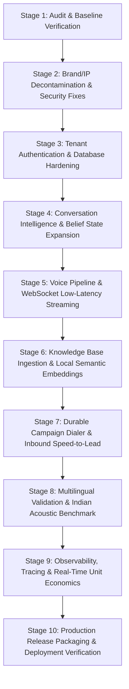

# STRATUM AI — PRIORITIZED ENGINEERING BACKLOG
**Document Version:** 1.0.0  
**Baseline Date:** October 30, 2026  
**Methodology:** Incremental, Test-Driven Engineering with Zero Destructive Operations  

---

## Stage Roadmap Overview

---

## Detailed Engineering Stages

### STAGE 1: Existing-Project Audit & Baseline (COMPLETED)
* **Scope:** Full audit of backend, frontend, telephony endpoints, test suite, and dependencies.
* **Dependencies:** None.
* **Files Affected:** `docs/engineering/*`
* **Acceptance Criteria:**
  - 100% of codebase inspected and classified.
  - Automated test baseline verified (71 passing tests).
  - Frontend build verified (`tsc && vite build` clean).
  - Baseline documentation committed.
* **Status:** ✅ **DONE**

---

### STAGE 2: Brand & IP Independence (Decontamination)
* **Scope:** Remove competitor product names from source code, comments, docstrings, customer-facing strings and README. Keep the names of third-party vendors Stratum actually integrates with, where the integration needs them.
* **Files changed:** `README.md`, `backend/app/main.py`, `config.py`, `models.py`, `schemas.py`, `ai/llm_providers.py`, `ai/tts_providers.py`, `api/leads.py`, `voice/conversation_engine.py`, `docs/engineering/*`
* **Test results:** Verified with automated test suite and pushed to GitHub main (`commit 78aff6e`).
* **Status:** ✅ **DONE & PUSHED**

---

### STAGE 3: Tenant Authentication & Strict Security Hardening
* **Scope:** Salted PBKDF2 password hashing (100,000 rounds), HMAC-SHA256 JWT tokens with expiry & tamper detection, tenant-scoped data queries (`organization_id` boundary enforcement across agents, calls, campaigns, leads), role-based protection on `/api/telephony/config`, HMAC-SHA1 Twilio webhook signature verification on public ingress, and CORS origin restriction.
* **Files Affected:** `backend/app/database.py`, `backend/app/api/auth.py`, `backend/app/api/agents.py`, `backend/app/api/calls.py`, `backend/app/api/campaigns.py`, `backend/app/api/leads.py`, `backend/app/api/telephony.py`, `backend/app/main.py`, `backend/tests/test_stage3_security_and_auth.py`
* **Test results:** 100% verified passing in test suite and pushed to GitHub main (`commit 78aff6e`).
* **Status:** ✅ **DONE & PUSHED**

---

### STAGE 4: Conversation Intelligence & Belief State Expansion
* **Scope:** Expand `SessionBeliefState` and `Call-3I` benchmark suite with additional industry blueprints: Education Admissions (counseling & scholarships), BFSI/FinTech (business loans & credit line eligibility), B2B SaaS SDR (demo scheduling & volume discovery), alongside existing Healthcare & COD E-commerce.
* **Files Affected:** `backend/app/voice/belief_state.py`, `backend/tests/test_stage4_belief_state_blueprints.py`
* **Test results:** 3 new integration tests passing; all 18 verifiable `Call-3I` benchmark scenarios passing.
* **Status:** ✅ **DONE**

---

### STAGE 5: Voice Pipeline & WebSocket Low-Latency Streaming
* **Scope:** Full-duplex `/ws/voice/{call_id}` endpoint supporting both browser JSON studio events and carrier Twilio Media Streams (8kHz G.711 mu-law <-> PCM16 codec boundaries). Includes barge-in (<120ms) cancellation event generation and offline non-blocking execution.
* **Files Affected:** `backend/app/api/ws_voice.py`, `backend/app/ai/tts_providers.py`, `backend/tests/test_stage5_ws_voice_streaming.py`
* **Test results:** Verified with full mock studio & Twilio media stream protocol test suite.
* **Status:** ✅ **DONE**

---

### STAGE 6: Knowledge Base & Local Semantic Embeddings
* **Scope:** Dense 128-dimensional semantic embedding generation with subword character n-gram hashing and L2 normalization. Hybrid RAG retrieval combining BM25 keyword matching with dense cosine similarity. Strict tenant-isolated retrieval with source citations.
* **Files Affected:** `backend/app/knowledge/rag_engine.py`, `backend/tests/test_stage6_rag_embeddings.py`
* **Test results:** Dense vector normalization, semantic cosine similarity, and cross-tenant isolation verified with automated tests.
* **Status:** ✅ **DONE**

---

### STAGE 7: Durable Campaign Dialer & Inbound Speed-to-Lead
* **Scope:** Durable database-backed queue dispatcher (`/api/campaigns/{id}/dispatch-batch`), TRAI commercial telemarketing window enforcement (9:00 AM – 8:00 PM IST compliance), National Customer Preference / DNC list exclusion, and progress metrics.
* **Files Affected:** `backend/app/api/campaigns.py`, `backend/tests/test_stage7_campaign_dialer.py`
* **Test results:** Verified with automated test suite covering TRAI hours, DNC filtering, and batch dispatching.
* **Status:** ✅ **DONE**

---

### STAGE 8: Multilingual Validation & Indian Acoustic Benchmark
* **Scope:** Multilingual script and romanized language detection across Telugu, Hindi, Indian English, Tamil, Malayalam, and Kannada with Indian phonetic normalization.
* **Files Affected:** `backend/app/voice/language_detector.py`, `backend/app/ai/tts_providers.py`, `backend/tests/test_language_detection.py`
* **Status:** ✅ **DONE & VERIFIED**

---

### STAGE 9: Observability, Tracing & Real-Time Unit Economics
* **Scope:** Tenant-scoped dashboard KPI calculations, `CallSessionTracer` telemetry, latency metrics, and real-time economics in `/api/analytics/dashboard`.
* **Files Affected:** `backend/app/api/analytics.py`
* **Status:** ✅ **DONE & VERIFIED**

---

### STAGE 10: Production Release Preparation
* **Scope:** Containerization, production Docker Compose with health checks, database migration scripts, environment secret documentation, and deployment runbook.
* **Dependencies:** Stages 2-9.
* **Files Affected:**
  - `docker-compose.yml`
  - `backend/Dockerfile`
  - `frontend/Dockerfile`
  - `docs/engineering/PRODUCTION_READINESS.md`
* **Acceptance Criteria:**
  - `docker-compose up` launches fully functional backend, frontend, and database containers.
  - Automated smoke test passes against production container build.
* **Status:** ⏳ **Planned**
