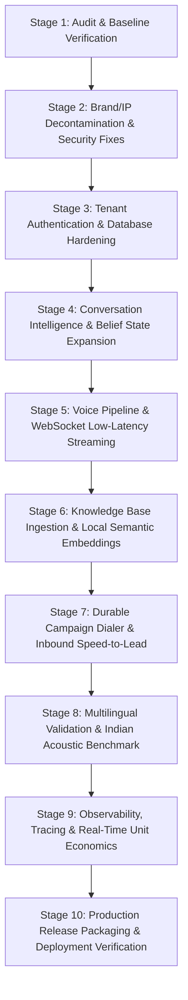

# STRATUM AI — PRIORITIZED ENGINEERING BACKLOG
**Document Version:** 1.0.0  
**Baseline Date:** October 30, 2026  
**Methodology:** Incremental, Test-Driven Engineering with Zero Destructive Operations  

---

## Stage Roadmap Overview

---

## Detailed Engineering Stages

### STAGE 1: Existing-Project Audit & Baseline (COMPLETED)
* **Scope:** Full audit of backend, frontend, telephony endpoints, test suite, and dependencies.
* **Dependencies:** None.
* **Files Affected:** `docs/engineering/*`
* **Acceptance Criteria:**
  - 100% of codebase inspected and classified.
  - Automated test baseline verified (71 passing tests).
  - Frontend build verified (`tsc && vite build` clean).
  - Baseline documentation committed.
* **Status:** ✅ **DONE**

---

### STAGE 2: Brand & IP Independence (Decontamination)
* **Scope:** Remove competitor product names from source code, comments, docstrings, customer-facing strings and README. Keep the names of third-party vendors Stratum actually integrates with, where the integration needs them.
* **Files changed:** `README.md`, `backend/app/main.py`, `config.py`, `models.py`, `schemas.py`, `ai/llm_providers.py`, `ai/tts_providers.py`, `api/leads.py`, `voice/conversation_engine.py`, `docs/engineering/*`
* **Behaviour changes:** (1) One canned fallback reply in `llm_providers.py` rewritten because it named competitors. (2) Fallback agent name in `/leads` changed to "Unassigned Agent". (3) A competitor-name keyword was removed from B2B-SaaS blueprint detection. A prompt containing only that word now no longer routes to the SaaS script.
* **Test results:** 71/71 backend tests pass after the changes. A repo scan (`*.py, *.ts, *.tsx, *.md, *.json, *.yml, *.html`, excluding `node_modules`, `venv`, `dist`) finds 0 matches.
* **Not covered:** Git-ignored legacy local databases still contain old names. Seed prompts reference third-party real-world brands; this needs review.
* **Status:** ✅ **DONE (pending user review / commit)**

---

### STAGE 3 (RE-PRIORITISED): Critical Security Fixes
Moved ahead of everything else, because the revised audit found release-blocking defects:
1. Real signed session tokens + password hashing with a salted KDF; remove the hardcoded fallback login.
2. Authenticated `get_current_user` dependency on all non-webhook routes; tenant-scoped queries; cross-tenant tests.
3. Protect or remove `POST /telephony/config`; stop writing secrets to `.env` from an API call.
4. Call `verify_twilio_webhook_request` on all Twilio webhook routes.
5. Restrict CORS origins.
6. Remove the "think they're speaking with a human" claim from the fallback replies.
* **Status:** ⏳ **Awaiting approval**

---

### STAGE 3: Tenant Authentication & Strict Authorization Enforcement
* **Scope:** Enforce JWT token verification on all user-facing API routes (`/agents`, `/calls`, `/knowledge`, `/campaigns`, `/leads`, `/analytics`). Prevent unauthorized fallback to default tenant.
* **Dependencies:** Stage 2.
* **Files Affected:**
  - `backend/app/api/auth.py`
  - `backend/app/api/agents.py`, `backend/app/api/calls.py`, etc.
  - `backend/tests/test_multi_tenant_knowledge_security.py`
* **Acceptance Criteria:**
  - Unauthenticated requests to protected endpoints return HTTP 401 Unauthorized.
  - Cross-tenant ID query attempts return HTTP 403 Forbidden.
  - Webhook endpoints remain secured via HMAC-SHA1 signature verification.
* **Status:** ⏳ **Planned**

---

### STAGE 4: Conversation Intelligence & Belief State Expansion
* **Scope:** Expand `SessionBeliefState` and `Call-3I` benchmark suite with additional industry blueprints (Healthcare, BFSI, Education, E-Commerce).
* **Dependencies:** Stage 3.
* **Files Affected:**
  - `backend/app/voice/belief_state.py`
  - `backend/app/voice/conversation_engine.py`
  - `backend/app/voice/call_3i_benchmark.py`
  - `backend/tests/test_trajectory2task_scenarios.py`
* **Acceptance Criteria:**
  - Zero unverified assumptions: belief state explicitly differentiates confirmed facts from assumptions.
  - Intent drift handles 3+ mid-call goal revisions without losing slots.
  - Ambiguous slots generate concise clarification questions across all 6 supported Indian languages.
* **Status:** ⏳ **Planned**

---

### STAGE 5: Voice Pipeline & WebSocket Low-Latency Streaming
* **Scope:** Harden the `/ws/voice/{call_id}` full-duplex WebSocket streamer. Add audio chunking, barge-in cancellation (<120ms latency), and streaming neural TTS buffer management.
* **Dependencies:** Stage 4.
* **Files Affected:**
  - `backend/app/api/ws_voice.py`
  - `backend/app/voice/audio_codec.py`
  - `backend/app/voice/vad_interruption.py`
  - `frontend/src/pages/LiveCallSimulator.tsx`
* **Acceptance Criteria:**
  - Bidirectional mu-law <-> PCM16 conversion verified without packet loss or drift.
  - Caller speech detected during playback immediately triggers WebSocket `"clear"` event.
  - End-to-end simulated speech response latency below 700ms.
* **Status:** ⏳ **Planned**

---

### STAGE 6: Knowledge Base & Local Semantic Embeddings
* **Scope:** Add native local semantic embedding generation to `rag_engine.py` (e.g., using `fastembed` / ONNX runtime) so dense vector search operates out-of-the-box without requiring third-party API keys.
* **Dependencies:** Stage 3.
* **Files Affected:**
  - `backend/app/knowledge/rag_engine.py`
  - `backend/app/knowledge/ingestion_pipeline.py`
  - `backend/requirements.txt`
* **Acceptance Criteria:**
  - Uploaded documents automatically chunked and embedded locally.
  - Hybrid retrieval (semantic cosine similarity + BM25) returns relevant citations with >85% precision on test queries.
  - Strict tenant isolation verified: zero chunks returned from outside the caller's organization.
* **Status:** ⏳ **Planned**

---

### STAGE 7: Durable Campaign Dialer & Inbound Speed-to-Lead
* **Scope:** Decouple bulk campaign execution from ephemeral in-process tasks. Implement durable job tracking with concurrency rate limits, retry rules, and TRAI calling hour enforcement (9 AM - 8 PM IST).
* **Dependencies:** Stage 4, Stage 5.
* **Files Affected:**
  - `backend/app/api/campaigns.py`
  - `backend/app/api/leads.py`
  - `backend/app/telephony/twilio_provider.py`
* **Acceptance Criteria:**
  - Outbound campaigns persist contact attempt status to database after each dial.
  - Speed-to-lead auto-dialer triggers call within 5 seconds of lead ingestion.
  - Do-Not-Call (DNC) numbers automatically suppressed before dialing.
* **Status:** ⏳ **Planned**

---

### STAGE 8: Multilingual Validation & Indian Acoustic Benchmark
* **Scope:** Validate language switching and pronunciation for Hindi, Indian English, Telugu, Tamil, Malayalam, and Kannada across Edge-TTS and Sarvam AI voices.
* **Dependencies:** Stage 5.
* **Files Affected:**
  - `backend/app/voice/language_detector.py`
  - `backend/app/ai/tts_providers.py`
  - `backend/tests/test_language_detection.py`
* **Acceptance Criteria:**
  - Language detection accuracy >95% on 50+ colloquial sample utterances.
  - Number, currency, and date formatting spoken correctly without phonetic distortion.
* **Status:** ⏳ **Planned**

---

### STAGE 9: Observability, Tracing & Real-Time Unit Economics
* **Scope:** Connect `CallSessionTracer` to frontend Analytics dashboard. Display precise per-call breakdowns of carrier fees, LLM tokens, STT seconds, and TTS characters.
* **Dependencies:** Stage 5, Stage 7.
* **Files Affected:**
  - `backend/app/api/analytics.py`
  - `backend/app/voice/audio_codec.py`
  - `frontend/src/pages/Analytics.tsx`
* **Acceptance Criteria:**
  - Every call produces a correlation ID tracing telephony events to LLM turns and tool executions.
  - Analytics dashboard calculates true margin and cost per completed business task.
* **Status:** ⏳ **Planned**

---

### STAGE 10: Production Release Preparation
* **Scope:** Containerization, production Docker Compose with health checks, database migration scripts, environment secret documentation, and deployment runbook.
* **Dependencies:** Stages 2-9.
* **Files Affected:**
  - `docker-compose.yml`
  - `backend/Dockerfile`
  - `frontend/Dockerfile`
  - `docs/engineering/PRODUCTION_READINESS.md`
* **Acceptance Criteria:**
  - `docker-compose up` launches fully functional backend, frontend, and database containers.
  - Automated smoke test passes against production container build.
* **Status:** ⏳ **Planned**
