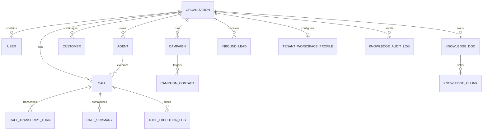

# STRATUM AI — SYSTEM ARCHITECTURE DOCUMENTATION
**Document Version:** 1.0.0 (Production Engineering Baseline)  
**System Name:** STRATUM AI — Enterprise Multilingual AI Calling SaaS Platform  
**Target Environment:** Cloud / Linux / Windows Server / Docker Containerized  

---

## 1. Executive Summary & Architectural Overview

Stratum AI is an enterprise-grade SaaS platform engineered for autonomous, human-like voice conversations across telephone networks (PSTN/VoIP) and interactive browser environments. Built with a modular Python/FastAPI backend and a React/TypeScript/Vite frontend, the system handles real-time audio ingestion, voice activity detection (VAD), streaming speech-to-text (STT), belief-state tracking, dynamic tool execution, LLM-driven response generation, neural speech synthesis (TTS), and telephony integration (Twilio/Exotel).

```
                      +------------------------------------------+
                      |         PSTN / Mobile Telephone          |
                      +------------------------------------------+
                                           |
                                [Carrier Telephony Gateway]
                                 (Twilio / Exotel / SIP)
                                           |
                   +-----------------------+-----------------------+
                   | HTTP Webhook (TwiML)                          | Bidirectional WebSocket
                   v                                               v
     +---------------------------+                   +---------------------------+
     | /api/telephony/twilio/... |                   |  /ws/voice/{call_id}      |
     |   (Turn-by-turn Gather)   |                   |  (Audio Streaming 8kHz)   |
     +---------------------------+                   +---------------------------+
                   |                                               |
                   +-----------------------+-----------------------+
                                           |
                                           v
                       +---------------------------------------+
                       |    VoiceConversationSession Engine    |
                       +---------------------------------------+
                                           |
      +-----------------+------------------+------------------+------------------+
      |                 |                  |                  |                  |
      v                 v                  v                  v                  v
+-----------+     +------------+     +-----------+     +------------+     +------------+
| Audio     |     | VAD &      |     | Multilin- |     | Belief     |     | RAG Engine |
| Codec     |     | Barge-In   |     | gual STT  |     | State      |     | (Tenant    |
| (mu-law / |     | (Energy /  |     | (Deepgram/|     | (Intent &  |     | Ingestion  |
| PCM16)    |     | Interrupt) |     | Sarvam)   |     | Slots)     |     | Pipeline)  |
+-----------+     +------------+     +-----------+     +------------+     +------------+
                                           |
                                           v
                       +---------------------------------------+
                       |   LLM & Tool Orchestration Layer      |
                       |   (Groq / OpenAI / Llama 3.3 / Tools) |
                       +---------------------------------------+
                                           |
                                           v
                       +---------------------------------------+
                       |   Neural Text-to-Speech (TTS)         |
                       |   (Edge-TTS / Sarvam / ElevenLabs)    |
                       +---------------------------------------+
                                           |
                                           v
                       +---------------------------------------+
                       | Telephony Playback / Audio Response   |
                       +---------------------------------------+
```

---

## 2. Technology Stack & Framework Inventory

### 2.1 Backend Core
* **Language & Runtime:** Python 3.11 - 3.14 compatible
* **Web Framework:** FastAPI (v0.115+) & Starlette
* **ASGI Server:** Uvicorn (HTTP/1.1 & WebSocket support)
* **Database & ORM:** SQLAlchemy 2.0 with SQLite (`stratum.db`) for zero-dependency local runs and PostgreSQL compatibility for production clustering.
* **Data Validation:** Pydantic v2
* **HTTP Client:** HTTPX (async client with connection pooling)
* **Audio & Signal Processing:** Python standard `audioop` / `wave` / custom mu-law and PCM16 transcoding algorithms.

### 2.2 Frontend Client
* **Framework:** React 18.3+ with TypeScript
* **Build Tool:** Vite 5.4+
* **Styling & Design System:** Tailwind CSS v3 with Lucide React iconography and light/dark theme persistence.
* **Audio Capture:** HTML5 Web Audio API (`AudioContext`, `ScriptProcessorNode`, dynamic PCM streaming).

---

## 3. Database Schema & Multi-Tenant Data Isolation

The database architecture enforces strict multi-tenancy at the data layer across all entity relationships:



### Core Entity Definitions:
1. **Organization (`organizations`):** Root multi-tenant entity representing client companies.
2. **User (`users`):** Authenticated team members with role-based access (`superadmin`, `admin`, `agent_manager`).
3. **Agent (`agents`):** Autonomous AI calling employees configured with prompts, blueprints, voice parameters, interruption thresholds, and qualification criteria.
4. **TenantWorkspaceProfile (`tenant_workspace_profiles`):** Company-level instructions, tone, product catalogues, operating policies, domain whitelists, and escalation boundaries.
5. **KnowledgeDoc & KnowledgeChunk (`knowledge_docs`, `knowledge_chunks`):** Ingested company documents (PDF, DOCX, TXT, CSV, Web URLs) chunked and isolated by `organization_id`.
6. **Call & CallTranscriptTurn (`calls`, `call_transcript_turns`):** Telephony call logs, duration, cost, latency tracking, and turn-by-turn conversational history.
7. **ToolExecutionLog (`tool_execution_logs`):** Cryptographically keyed idempotency log of mid-call tool invocations, parameters, results, and latency.

---

## 4. Subsystem Breakdown

### 4.1 Voice Conversation Engine (`app/voice/conversation_engine.py`)
* Coordinates conversational turns, intent tracking, RAG context injection, and response synthesis.
* Enforces tenant verification before executing any call action.
* Integrates `SessionBeliefState` to track missing, ambiguous, and changing slots dynamically.

### 4.2 Belief State & Intent Tracking (`app/voice/belief_state.py`)
* Implements a POMDP-inspired slot tracking system adapted from Trajectory2Task principles.
* Distinguishes confirmed user facts from assumptions.
* Detects intent drift (e.g., booking to cancellation) and triggers natural slot clarification questions in English, Hindi, Telugu, Tamil, Malayalam, and Kannada.

### 4.3 Tool Execution Runtime (`app/voice/tool_runtime.py`)
* Provides keyword-triggered, schema-validated execution for business tools (see Section 5 for the actual tool list).
* Enforces preconditions (e.g., cannot book without required slots).
* Idempotency checking via SHA-256 argument hashing to prevent duplicate transactions.

### 4.4 Telephony Transport Layer (`app/telephony/`)
* **TwilioProvider:** Outbound call creation, TwiML generation, and WebSocket audio streaming code. Signature verification helpers exist but are not yet wired into routes.
* **ExotelProvider:** Indian telecom gateway integration with TRAI compliance.
* **WebSimulatorProvider:** Browser-based full-duplex conversational testing without telecom charges.

### 4.5 Knowledge Base & RAG Pipeline (`app/knowledge/`)
* Ingestion pipeline with file validation, URL crawling, and content extraction.
* Built-in security:
  * SSRF prevention on website URLs (blocking loopback, private IP ranges, cloud metadata endpoints).
  * Prompt injection sanitizer scanning documents for jailbreaks and instruction override attempts.
  * Audit logging for all document actions.

---

## 5. Security Architecture (current state — see EXISTING_FEATURE_AUDIT.md)

> Revision 1.1 correction: revision 1.0 of this section described controls that are not actually in place.

1. **Tenant isolation:** Enforced only inside `VoiceConversationSession` (call vs. agent org check) and RAG search. **Not enforced on REST routes.**
2. **Authentication:** Not functional. Tokens are unsigned and no route checks them.
3. **Credentials:** Stored in git-ignored `.env`. `/telephony/status` returns a masked SID. `/telephony/config` is unauthenticated and writes secrets to `.env`.
4. **Webhook security:** HMAC-SHA1 verification helpers exist in `twilio_security.py`, but no route calls them.
5. **Tool runtime:** Idempotency key is SHA-256 of tool name + arguments. Tools are triggered by keyword rules. Tool list: order status, COD confirm/cancel, address change, slot check, book/reschedule/cancel appointment, EMI calculation, WhatsApp dispatch.
6. **Retrieval:** Token-overlap similarity. No embeddings.
